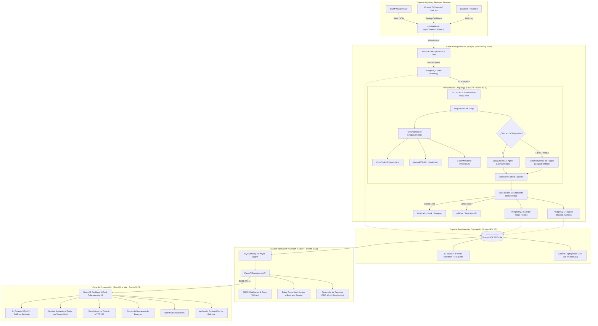

# 01. Arquitectura del Sistema — SOC-Lite

## 1. Visión General y Propósito

**SOC-Lite** es una plataforma de orquestación, triaje y respuesta automatizada ante incidentes de ciberseguridad (SOAR ligero) diseñada específicamente para pequeñas y medianas empresas (PYMEs), entidades intermedias y administraciones públicas. Resuelve la brecha crítica entre la generación masiva de alertas por sistemas SIEM (como Wazuh o Snort/Suricata) y la capacidad operativa reducida de los equipos de seguridad, donde entre el 70% y el 90% de las alertas corresponden a falsos positivos o eventos de ruido operacional.

El sistema garantiza:
- **Reducción radical del MTTT (Mean Time to Triage):** de horas o días a menos de 90 segundos por evento.
- **Operación continua 24/7 resiliente:** triaje autónomo con motor heurístico degradado ante indisponibilidad del modelo de lenguaje (LLM).
- **Cumplimiento normativo estricto:** alineación con **NIST CSF v2.0 (DE.AE - Anomalies and Events)**, **ISO/IEC 27001:2022 (Controles A.8.15 Registro de eventos y A.5.24 Planificación y preparación de la gestión de incidentes)** y mapeo táctico con **MITRE ATT&CK v14**.

---

## 2. Diagrama de Arquitectura de Tres Capas

---

## 3. Principios de Diseño No Negociables

1. **El Agente LLM Propone, No Ejecuta:** Toda acción destructiva o de contención crítica (bloqueo en firewall, aislamiento de host) requiere confirmación humana ("Human-in-the-Loop"). La IA genera enriquecimiento, veredicto, puntuación de confianza y sugerencias, pero el sistema aplica validación con esquemas Pydantic antes de escribir en base de datos.
2. **Resiliencia y Cero Punto Único de Falla:** Si el runtime de inferencia local (Ollama) o el LLM sufren caídas por agotamiento de VRAM o timeouts, el microservicio conmuta inmediatamente al **Motor Heurístico de Reglas**, marcando la ejecución con `execution_mode = 'degraded'`. La alerta nunca se descarta ni se pierde.
3. **Inmutabilidad y Trazabilidad Forense:** Toda acción efectuada por operadores humanos, automatismos de n8n o servicios de IA queda registrada en la bitácora `audit_log`, encadenada mediante hashes SHA-256 (`curr_hash = SHA256(prev_hash + ...)`) garantizando no-repudio según ISO 27001 A.8.15.
4. **Privacidad de Datos (Data Privacy First):** El triaje por defecto utiliza modelos locales en Ollama (`llama3:8b`, `mistral:7b`), asegurando que información sensible de red, identidades internas e IPs privadas no se filtren a proveedores de nube pública.

---

## 4. Registro de Decisiones de Arquitectura (ADRs)

### ADR-001: Arquitectura Híbrida n8n + Microservicio LangChain (FastAPI)
- **Decisión:** Utilizar n8n como orquestador de integración externa (webhooks, reintentos, colas, notificaciones Slack, creación de tickets) y desacoplar la inteligencia en un microservicio Python con LangChain y FastAPI.
- **Alternativa descartada:** LangFlow o n8n con nodos de IA nativos. LangFlow se queda corto para flujos de producción con validación estricta de esquemas Pydantic, herramientas complejas multietapa y fallback heurístico con degradación controlada.
- **Coste de la decisión:** Requiere mantener dos runtimes (Node.js para n8n y Python 3.11+ para LangChain), aumentando ligeramente el consumo de memoria (~300MB adicionales).

### ADR-002: Base de Datos Principal en PostgreSQL con Tipos Nativos
- **Decisión:** Emplear PostgreSQL 16 con tipos nativos avanzados: `JSONB` para cargas crudas y respuestas de threat intelligence, `INET` para filtrado y consultas de rangos CIDR de IPs, `ARRAY` para etiquetas y recomendaciones, y `ENUM` para integridad referencial estricta de estados y severidades.
- **Alternativa descartada:** MongoDB o Elasticsearch como almacén primario. Aunque ofrecen búsqueda no estructurada, carecen de integridad transaccional ACID para bitácoras criptográficas encadenadas y requieren cálculos manuales para percentiles P95 que PostgreSQL resuelve nativamente con `percentile_cont(0.95) WITHIN GROUP (ORDER BY ...)`.
- **Coste de la decisión:** Requiere migraciones controladas de esquema y estructuración estricta en tablas relacionales.

### ADR-003: FastAPI + SQLAlchemy 2.0 Async
- **Decisión:** Implementar el backend con FastAPI y SQLAlchemy 2.0 en modo asíncrono puro (`asyncpg`).
- **Alternativa descartada:** Django o Flask. Flask es sincrónico y penaliza la concurrencia en I/O masivo; Django añade sobrecarga innecesaria para una arquitectura desacoplada centrada en microservicios y REST APIs.
- **Coste de la decisión:** Curva de aprendizaje más pronunciada en la gestión de sesiones asíncronas de SQLAlchemy y transacciones concurrentes.

### ADR-004: Frontend SPA con React 18, Vite y TypeScript
- **Decisión:** Desarrollar el cliente web en React 18 con TypeScript estricto, empaquetado ultra-rápido mediante Vite, y visualización de telemetría mediante Recharts.
- **Alternativa descartada:** Next.js o plantillas server-rendered. Para una consola operativa de SOC cerrada a usuarios autenticados, el SSR introduce complejidad de infraestructura innecesaria sin aportar beneficios de SEO público.
- **Coste de la decisión:** Renderizado en el cliente; requiere empaquetado optimizado (`splitChunks` en vendors) para reducir el tamaño del bundle inicial.

---

## 5. Matriz de Riesgos y Mitigaciones

| Riesgo Técnico / Operacional | Severidad | Probabilidad | Estrategia de Mitigación |
|-----------------------------|-----------|--------------|--------------------------|
| **Caída o saturación de Ollama (VRAM exhausta)** | Crítica | Media | Fallback inmediato a motor heurístico estático con flag `degraded`. Alertas encoladas en n8n con reintentos exponenciales. |
| **Fatiga de alertas por tormenta de logs (DDoS/Escaneo)** | Alta | Alta | Nodo IF en n8n con ventana de deduplicación basada en `source_ip + alert_type` en caché/BD de 10 minutos. |
| **Manipulación o borrado no autorizado de auditoría** | Crítica | Baja | Doble capa de auditoría; tabla `audit_log` con hash encadenado SHA-256; permisos REVOKE para UPDATE y DELETE a nivel de rol de BD. |
| **Alucinación del LLM en severidad o recomendaciones** | Alta | Media | Esquema estricto Pydantic con Enum coercitivo; validación de reglas de negocio mínimas (si VT > 10 detecciones, severidad no puede ser 'low'). |
| **Latencia elevada en consultas externas de Threat Intel** | Media | Alta | Caching de IOCs con TTL de 24 horas y ejecución concurrente asíncrona mediante `httpx.AsyncClient` con timeout estricto de 3.5 segundos. |
