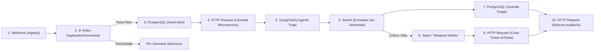

# 05. Workflow de Triaje Automatizado — n8n

## 1. Visión General del Workflow

El orquestador **n8n** actúa como el bus de integración de eventos de seguridad de **SOC-Lite**. Recibe alertas crudas de sistemas SIEM (Wazuh) y cortafuegos (OPNsense), las normaliza, filtra duplicados, las persiste en PostgreSQL, invoca el microservicio de agentes LangChain para su enriquecimiento contextual y triaje cognitivo, y orquesta las acciones de respuesta (notificaciones a canales de guardia y creación de tickets de soporte).

---

## 2. Los 10 Nodos del Flujo Principal

| # | Nombre del Nodo | Tipo de Nodo n8n | Función Específica | Entrada → Salida |
|---|-----------------|------------------|--------------------|------------------|
| **1** | **Webhook Ingest** | `n8n-nodes-base.webhook` | Escucha eventos JSON de Wazuh y OPNsense en `/webhook/alerts` | Payload JSON crudo → Payload estructurado normalizado |
| **2** | **Filter & Deduplicate** | `n8n-nodes-base.if` | Filtra alertas repetidas en ventana de 10 min y descarta severidad info sin impacto | Payload normalizado → Booleano (`true`/`false`) |
| **3** | **Persist Alert DB** | `n8n-nodes-base.postgres` | Inserta la alerta en la tabla `alerts` con estado inicial `'pending'` | Payload normalizado → `alert_id` (UUID) |
| **4** | **Call LangChain Service** | `n8n-nodes-base.httpRequest` | Invoca `POST http://langchain-service:8001/api/v1/triage` | `alert_id`, IP origen, título, payload → JSON de triaje |
| **5** | **Agent Intelligence** | Microservicio Python | Consulta VirusTotal, AbuseIPDB y GeoIP, razona con LLM/heurística y valida con Pydantic | Alerta enriquecida → Veredicto, severidad, acciones |
| **6** | **Switch by Severity** | `n8n-nodes-base.switch` | Bifurca el flujo según la severidad evaluada (`critical`/`high` vs `medium`/`low`) | Veredicto + severidad → Salida de canal 0, 1 o 2 |
| **7** | **Persist Triage DB** | `n8n-nodes-base.postgres` | Guarda el resultado en `triage_results` y actualiza `alerts.status` | Triaje JSON → Registro en BD |
| **8** | **Notify High Threats** | `n8n-nodes-base.slack` / `httpRequest` | Despacha notificación a canal #soc-alertas con resumen ejecutivo | Alerta crítica/alta → Mensaje formateado en Slack |
| **9** | **Create Ticket** | `n8n-nodes-base.httpRequest` | Abre ticket de incidente en osTicket / Redmine con datos del atacante | Triaje + severidad → `ticket_id` externo |
| **10** | **Register Audit Log** | `n8n-nodes-base.httpRequest` | Envía evento de negocio a `/api/v1/audit` para encadenamiento SHA-256 | Acción de triaje completada → Confirmación de hash |

---

## 3. Nodos de Apoyo y Resiliencia (Error Trigger)

Además de los 10 nodos principales, el flujo implementa:
1. **Error Trigger (`n8n-nodes-base.errorTrigger`):** Captura cualquier excepción no controlada en la ejecución de nodos (ej. desconexión transitoria de red con el microservicio de LangChain).
2. **Update Alert State on Error (`n8n-nodes-base.postgres`):** Actualiza el estado de la alerta a `'in_progress'` y anota la falla técnica en los tags.
3. **Log Execution Failure (`n8n-nodes-base.httpRequest`):** Registra el incidente de ejecución en la bitácora de auditoría con resultado `'failure'`, preservando la trazabilidad forense.

---

## 4. Política de Idempotencia y Reintentos

- **Idempotencia:** Cada alerta entrante genera una clave de unicidad calculada como:
  $$\text{idempotency\_key} = \text{MD5}(\text{source} \,||\, \text{source\_ip} \,||\, \text{rule\_id} \,||\, \text{date\_window\_10m})$$
  Si una alerta con la misma clave ingresa dentro de la ventana de 10 minutos, el nodo IF la reconoce como duplicado y evita la doble persistencia o duplicación de tickets.
- **Reintentos en Llamadas HTTP:**
  - Nodos HTTP (llamada al microservicio LangChain, Slack y osTicket) configurados con **3 reintentos automáticos**, retroceso exponencial (*exponential backoff*) y tiempo inicial de espera de 2.000 ms con variación aleatoria (*jitter*).

---

## 5. Validación Cruzada de Columnas SQL con `schema.sql`

| Nodo n8n | Tabla SQL | Columnas Referenciadas en n8n | Coincidencia en `schema.sql` |
|----------|-----------|--------------------------------|------------------------------|
| **Nodo 3 (Persist Alert)** | `alerts` | `id`, `external_id`, `title`, `description`, `source`, `severity`, `status`, `source_ip`, `destination_ip`, `raw_payload`, `tags` | **100% Exacto** |
| **Nodo 7 (Persist Triage)** | `triage_results` | `id`, `alert_id`, `verdict`, `severity`, `confidence`, `reasoning`, `recommended_actions`, `ai_model`, `execution_mode`, `execution_time_ms` | **100% Exacto** |
| **Nodo 7 (Update Status)** | `alerts` | `status`, `updated_at` | **100% Exacto** |
| **Nodo 10 (Audit Log)** | `audit_log` | `username`, `module`, `action`, `target_id`, `details`, `result`, `ip_address` | **100% Exacto** |
